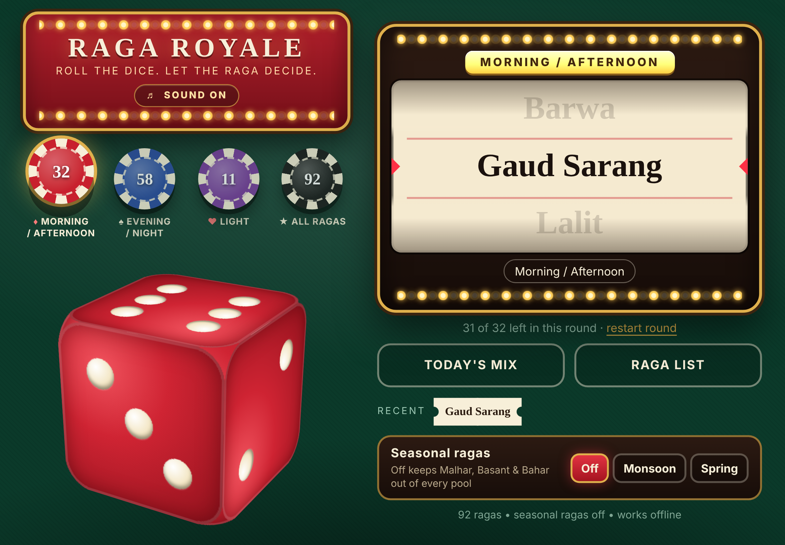
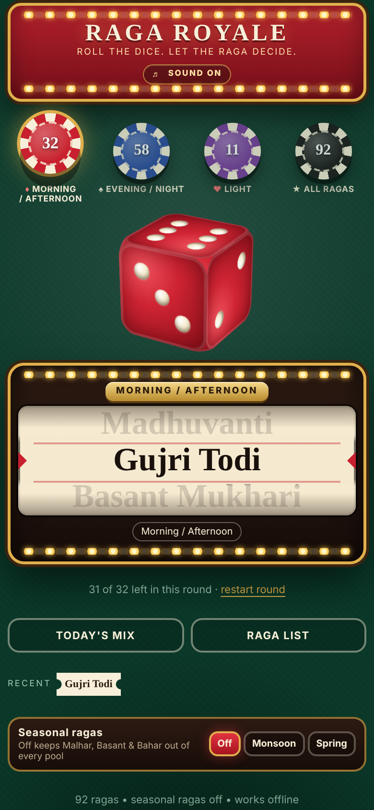

# Raga Royale

Roll the dice and let the raga decide. A single-file, offline-capable practice companion for Hindustani ragas: big 3D dice, casino-style reel, and three practice pools so the morning ragas stop getting ignored.

 

## Pools
| Pool | What's in it | Count |
|---|---|---|
| Morning / Afternoon | proper full classical ragas | 32 |
| Evening / Night | proper full classical ragas | 58 |
| Light | thumri-type (Pilu, Bhairavi, Kafi, Khamaj, Pahadi...) | 11 |
| All | everything | |
| Monsoon / Spring | only roll when that season is switched on | 6 / 6 |

Today's Mix rolls one from each pool. Draws use a shuffle bag, so nothing repeats until the round is done.

## Deploy on GitHub Pages
1. Create a repo called `raga-royale` and upload everything in this folder (keep `.nojekyll`).
2. Settings > Pages > Deploy from branch > `main` / root.
3. Open https://saptakmp3.github.io/raga-royale/

Reusing an old repo? Replace the old `service-worker.js`, `manifest.json` and icons with these.

## Install on iPad / iPhone
Safari > Share > Add to Home Screen. Works offline after the first load.

## Edit the ragas
Open `index.html` and search for `DAY`, `NIGHT`, `LIGHT`, `MONSOON`, `SPRING`, `OTHER`. One name per entry.

## Updating
After any change, bump `VERSION` in `service-worker.js` (`v1` to `v2`) so installed copies refresh.

## Saved data
localStorage keys: `randomRaga.v2` (shuffle bags, history, season), `ragaRoyale.sound.v1` (sound toggle).

## Layout notes
Portrait is the original layout. Landscape (width over 600px) draws two panels at 820x560 and scales to fit, with the Raga List as a slide-over. Sounds are embedded in the HTML on purpose (iOS Safari + service workers handle external audio badly).
